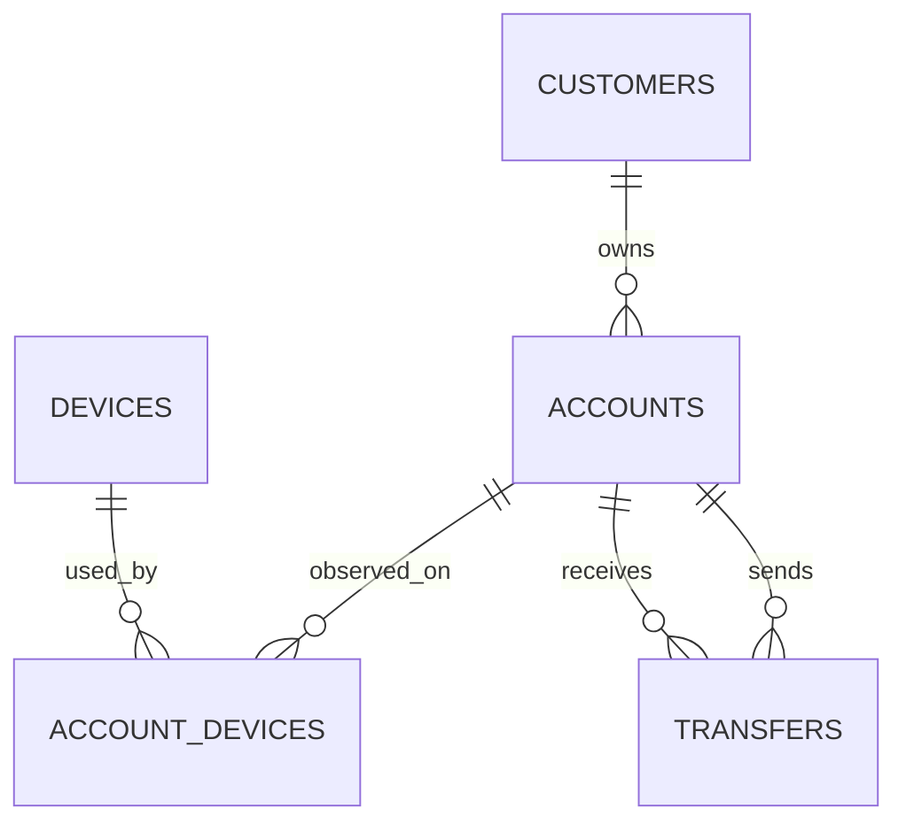
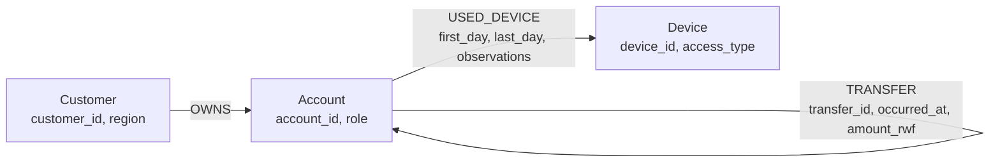

# Mobile Money Analytics - Project 2 Report Draft

> Draft based on verified local runs. Member reflections and contribution attribution still require member review. Required UI screenshots and the final repository URL remain to be added.

## 1. Team and environment

- Group members and student IDs: UWAYEZU Bienvenu (101362 UF); UMUHOZA Fabiola (101361 PN); Paulin NKUSI (101397)
### Individual reflections (drafts for member review)

**UWAYEZU Bienvenu (101362 UF) - PostgreSQL Q7 improvement.** In measured PostgreSQL runs, the improved Q7 returned the shortest person-only transfer distance for both review sets. At depth four, its median was 0.508 seconds for set B and 0.432 seconds for set E, compared with baseline medians of 28.013 and 32.936 seconds. At depth six, improved medians were about 35 to 36 seconds; the baseline timed out for B and was not measured for E. The improvement deduplicates account/depth states, avoiding exploration of many routes that reach the same account at the same distance. This is an algorithm change within SQL, not proof that a relational model is inherently faster than a graph. I would change my conclusion if the selected routes or lengths failed an independent edge-by-edge check, or if repeated runs under identical resource settings removed the speed difference. I would verify every returned account role and transfer direction, then rerun all four cases under controlled cache conditions. These are structural connections only and do not establish that money moved onward.

**UMUHOZA Fabiola (101361 PN) - concurrent Q7 workload.** PostgreSQL completed the measured Q7 requests at one and four clients, with median throughput of 0.0276 and 0.0922 correct requests per second. At eight and sixteen clients, all 72 and 144 measured requests timed out across three repetitions; there were no incorrect results. Neo4j completed this workload at every client level, reaching median throughput of 746 correct requests per second at sixteen clients, with a 0.041 second median repetition p95. This is a large difference for the selected query, bound, dataset, machine, and settings, not a universal engine ranking. I would revisit the explanation if a controlled repeat changed the timeout pattern or if plans showed the SQL time went to avoidable traversal work. A useful next check is to inspect the Q7 plan and compare PostgreSQL resource use during the timeout runs. Resource profiling would help explain the cause. Throughput, p95, and timeouts belong together: a zero-completion run cannot be described by latency alone.

**Paulin NKUSI (101397) - captured data and integrity.** The capture contains 20,003,300 transfers with a total amount of RWF 231,482,327,870. PostgreSQL and Neo4j both matched the source audit, and all 61 SQL/Cypher result cases passed exact comparison. An independent check also scanned the transfer CSV and confirmed sampled aggregates and returned transfer-chain/cycle events. I interpret this as evidence that both representations preserve the queried facts and that the implementation is reproducible for these generated records. It is not evidence of fraud: device intervals indicate observed use, and the ledger is incomplete. A check that could overturn my confidence would be a full reconciliation of transfer IDs and endpoint/time/amount properties across every imported event, followed by rerunning comparison from fresh imports. Any missing or duplicated relationship could affect path results even if aggregate totals matched. I would ask for authoritative ledger records and device ownership context before recommending an account for investigation. The row totals establish consistency, not completeness of real-world evidence.

**Contribution attribution and assistance.** The group should confirm which member completed each project task; individual task ownership was not provided, so this report does not assign unverified contributions. Codex/LLM assistance was used to implement and debug the capture/database/query/benchmark scripts, interpret measured output, and draft these reflections. The results were checked by running the programs against the captured data, comparing all 61 SQL/Cypher cases, reconciling audits, and independently checking selected rows and paths. Each member should review their reflection and be prepared to explain the relevant query and evidence.
- Machine: HP ENVY x360 2-in-1 Laptop 13-bf0xxx; 12th Gen Intel Core i7-1250U (12 logical processors); 15.70 GiB RAM; Windows 10 Pro, display version 26H2, build 26300.
- Python and package versions: Python 3.14.4; Neo4j Python driver 6.4.0; psycopg2 2.9.11; NumPy 2.5.0; Matplotlib 3.11.1
- PostgreSQL: Timescale Docker, PostgreSQL 17.11, host port 5433; project database timezone Africa/Kigali. Observed settings: shared_buffers 1,947 MB, work_mem 5,192 kB, effective_cache_size 5,841 MB.
- Neo4j Community: 2026.09.0; Java 21.0.9
- Neo4j DBMS: dedicated local instance; Bolt endpoint `bolt://127.0.0.1:7687`; default database `neo4j`. Configured heap 512 MB initial / 1 GB maximum and page cache 512 MB.

## 2. Data capture and validation

The supplied generator was left unchanged. Capture completed for all five streams, and the independent CSV audit passed.

| CSV stream | Rows |
| --- | ---: |
| Customers | 228,000 |
| Accounts | 248,000 |
| Devices | 228,600 |
| Account-device associations | 285,600 |
| Transfers | 20,003,300 |

Account roles: 240,000 person, 6,000 merchant, 2,000 agent. Transfer audit: 20,003,300 rows, total amount RWF 231,482,327,870, earliest epoch 1,788,235,200, latest epoch 1,790,798,399. See `results/capture_verification.json`.

## 2. PostgreSQL model

`customers` stores integer customer IDs and region. `accounts` stores integer wallet IDs, owner IDs, and person/merchant/agent roles. `devices` stores integer device IDs and handset/terminal type. `account_devices` stores an account-device observation with inclusive September day offsets `first_day`/`last_day` (0-29) and positive observation count. `transfers` stores a unique BIGINT event ID, integer sender and receiver IDs, Unix epoch seconds, and positive integer amount in RWF. Primary/foreign keys preserve identities and endpoints; checks enforce positive amount/count and valid day intervals. Device intervals indicate observed association only, not which handset initiated a transfer.

## 3. PostgreSQL implementation and results

The schema, dependency-ordered bulk loader, and index script (`postgres_schema.sql`, `load_postgres.py`, `postgres_indexes.sql`) completed successfully against the registered Timescale Docker server.

- Table load seconds: customers 0.279; devices 0.264; accounts 6.080; account-device associations 12.618; transfers 1,007.400. Index creation and analysis: 76.395 seconds.
- Counts, role totals, and transfer audit matched the captured CSVs. All constraints were validated, and all five required indexes were present. See `results/postgres_load.json`.
- PostgreSQL database size: 3,727,292,083 bytes; table and TOAST data: 1,249,927,168 bytes; indexes: 2,467,766,272 bytes. Transfer indexes: 2,433,499,136 bytes.
- All paired query results passed the 61-case comparison. Required plans are in `results/plans.json`; the improved PostgreSQL Q7 plan and all three Neo4j profiles completed. The PostgreSQL baseline Q7 bound-6 plan exceeded the 180-second collection limit, consistent with its benchmark timeouts.

## 4. Neo4j graph model

Every PostgreSQL fact has a graph counterpart: customer/account/device IDs and descriptive properties become node properties; account ownership and device observations become directed relationships with the original interval/count properties; each transfer row becomes its own directed relationship so repeated payments retain separate IDs, times, and amounts. Collapsing parallel transfers would lose individual event evidence and the ordering needed for chain/cycle analysis.

## 4. Neo4j implementation and results

The dedicated Neo4j Community database imported successfully. `results/neo4j_import.json` records 704,600 nodes, 20,536,900 relationships, and an import duration of 64.194 seconds. `results/neo4j_setup.json` records passing checks for required counts, all three role totals, 20,003,300 unique transfer IDs, transfer audit totals, zero accounts with an incorrect owner, and online uniqueness constraints and transfer-time index. Store size: 2,967,030,654 bytes; transaction log size: 6,930 bytes.

### Cypher query smoke runs

`results/neo4j_smoke.json` contains a loaded-data example for each Q1-Q7, with each executed query's returned rows and elapsed time. Q2 returned 30 date groups in 156.485 seconds. Q6 used the explicit 3-8-edge branch implementation to complete in 11.011 seconds. These are smoke results, not the full 61-case comparison or formal benchmark.

An independent scan of all 20,003,300 transfer rows and the source device CSVs passed the Q1/Q2 aggregate, Q3 device-overlap, and Q5/Q6 path checks. Evidence: `results/query_sample_verification.json`.

## 5. SQL/Cypher correctness comparison

The comparison runner implements 61 cases across the six required account sets and query/depth combinations. The complete rerun passed with both databases running and transaction-level Neo4j timeouts.

- Passed / mismatched cases: **61 / 0**
- Independent CSV spot checks for Neo4j Q1/Q2/Q3/Q5/Q6: **PASS** (`results/query_sample_verification.json`)
- Eight reachable person-only Q7 paths were retrieved and verified edge by edge against PostgreSQL; all lengths match (`results/q7_path_verification.json`).
- Evidence: `results/correctness_61.json`

## 6. Performance and concurrency

The PostgreSQL benchmark runner records the 21 required query cases with three warm-ups and five measured runs. The baseline run was interrupted during set E/depth 6. Baseline Q7 depth-4 medians were 28.013 seconds (B) and 32.936 seconds (E). Set B/depth 6 timed out in all warm-ups and measured runs; set E/depth 6 baseline has one warm-up timeout and no measured runs.

The improved SQL Q7 medians were 0.508 seconds (B/depth 4), 0.432 seconds (E/depth 4), 34.906 seconds (B/depth 6), and 36.177 seconds (E/depth 6). It completed all four cases. Raw runs are retained in `results/benchmark_postgresql_baseline.jsonl` and `results/benchmark_postgresql_improved.jsonl`.

PostgreSQL Q4 concurrency medians (three repetitions each) were:

| Clients | Correct throughput (requests/s) | p95 latency (s) | Errors/timeouts/incorrect |
|---:|---:|---:|---:|
| 1 | 25.025 | 0.094 | 0/0/0 |
| 4 | 80.377 | 0.115 | 0/0/0 |
| 8 | 105.269 | 0.187 | 0/0/0 |
| 16 | 101.167 | 0.367 | 0/0/0 |

Neo4j completed every required benchmark case except Q2. All five Q2 measured runs exceeded the actual 60-second transaction timeout and are recorded as timeouts, with no latency median. PostgreSQL Q2's median was 2.778 seconds. Other Neo4j measured medians were 10-55 ms for Q1/Q3-Q6. Selected Q7 results show the impact of search bounds: at bound 4 PostgreSQL's improved medians were 0.508 s (B) and 0.432 s (E), while Neo4j took 7.968 s and 6.229 s because those searches did not find a route within four transfers. At bound 6 PostgreSQL took 34.906 s (B) and 36.177 s (E); Neo4j took 0.016 s and 0.020 s after finding routes. These results depend on both the query implementation and whether a route is found within the bound.

Concurrency medians (three repetitions each) are summarized below. For PostgreSQL Q7, all requests completed at one and four clients. At eight and sixteen clients, every measured request timed out; warm-up failures are counted separately. Neo4j Q7 completed at all client levels.

| Engine / workload | 1 client throughput / p95 | 4 clients | 8 clients | 16 clients |
|---|---:|---:|---:|---:|
| PostgreSQL Q4 | 25.0 / 0.094 s | 80.4 / 0.115 s | 105.3 / 0.187 s | 101.2 / 0.367 s |
| Neo4j Q4 | 30.4 / 0.090 s | 99.7 / 0.124 s | 155.6 / 0.175 s | 122.9 / 0.387 s |
| PostgreSQL Q7 | 0.0276 / 38.329 s | 0.0922 / 46.954 s | 0 / all time out | 0 / all time out |
| Neo4j Q7 | 138.8 / 0.011 s | 605.8 / 0.011 s | 730.1 / 0.023 s | 746.1 / 0.041 s |

Raw benchmark records, per-repetition concurrency logs, summaries, and refreshed charts are retained in `results/`.

Charts are embedded above and retained as PNGs in `results/` for reuse in the final PDF.
## 7. Discussion and limitations

The PostgreSQL baseline-to-improved Q7 result shows why query design must be separated from data model: deduplicating account/depth states reduced depth-four medians dramatically and made set B depth-six finish within the measurement timeout. Depth-six remained much more expensive. Q4 throughput rose through eight clients and flattened or fell at sixteen in both engines as p95 latency rose. For Q7, Neo4j sustained the tested workload at all client counts, while PostgreSQL timed out at eight and sixteen clients. This evidence applies to the selected query implementations, machine, and settings, not universally to either engine.

For routine grouped reporting, PostgreSQL offers direct aggregates over the ledger and clear constraint/index checks. For multi-hop account exploration, Neo4j expresses ownership/device/transfer connections directly, while recursive SQL remains viable and a better SQL algorithm materially changes the comparison. A reasonable operational design is PostgreSQL as the authoritative ledger/reporting store and a refreshed Neo4j copy for exploratory traversals, with a defined freshness target and audit of replication lag. A stale graph could miss new transfers or retain reversed events; neither result should drive action without checking current source records. Limits include synthetic/incomplete event data and measurements from one machine/configuration. Device overlap and transfer paths are leads for review, not proof of common control or funds movement.

## 8. Investigation priorities and recommendation

| Pair | Review / destination | Q3 shared-device rows | Q4 connected accounts at 10 links | Q5 rapid chains | Q6 cycles | Q7 minimum transfers (bound 6) | First review |
|---|---|---:|---:|---:|---:|---|---|
| A / D | 998 -> 24755 / 237998 -> 21755 | 4 / 4 | 187 / 192 | 1 / 0 | 1 / 0 | 3 / 3 | A (998), because a rapid chain and return cycle were both found |
| B / E | 147228 -> 186823 / 144228 -> 183823 | 9 / 9 | 228 / 230 | 1 / 0 | 0 / 0 | 5 / 5 | B (147228), due to the rapid chain; other signals are similar |
| C / F | 206978 -> 6573 / 203978 -> 3573 | 9 / 9 | 1,433 / 1,426 | 1 / 0 | 1 / 0 | 5 / 5 | C (206978), because a rapid chain and return cycle were both found |

For set A, the captured chain was 998 -> 8917 -> 16836 -> 24755. Transfers 20,000,001-20,000,003 occurred at 10:00:00, 10:00:40 and 10:01:20 CAT with amounts RWF 200,000, 196,000 and 192,080. Transfer 20,000,004 returned 24755 -> 998 at 10:02:00 for RWF 188,238, forming a four-transfer cycle within the allowed window. The Q3 query also found account 16836 sharing handset/device 228001 with account 998 over inclusive days 0-29. Household use, shared custody, or a public/agent setting could explain a device association; interval overlap does not prove simultaneous use or who initiated a payment. Request the provider's authoritative ledger, account/device registration and user evidence before escalating; the generated activity alone cannot establish fraud.

For this generated dataset, PostgreSQL is a sensible authoritative store for constrained ledger data and grouped reporting. Neo4j makes connected-account traversals direct to express and performed strongly on the tested person-only Q7 workloads, while the SQL improvement materially changed PostgreSQL's results. A production graph copy should have an explicit refresh target and lag audit; stale transfers can hide or falsely retain routes. Limits: the events are synthetic and incomplete, and results reflect one machine, dataset, resource configuration, and query implementation.

## 8. Submission evidence checklist

- [x] Capture verification JSON
- [x] Neo4j import and integrity verification JSON
- [x] Q1-Q7 Neo4j smoke rows
- [x] PostgreSQL load and integrity verification
- [x] 61-case correctness results and CSV spot checks
- [x] Neo4j benchmark suite (Q2 recorded as five 60-second measured timeouts)
- [x] PostgreSQL and Neo4j plans/profiles (baseline PostgreSQL Q7 bound-6 plan timed out at 180 seconds)
- [x] Both concurrency matrices, summaries, and refreshed charts
- [ ] Required screenshots with taskbar and clock visible
- [x] Group details and draft individual reflections (member review needed)
- [x] Local source/results review ZIP (CSV data, database stores, and `.env` excluded)
- [ ] Final PDF after screenshots and member review
- [ ] Repository URL and matching final ZIP
